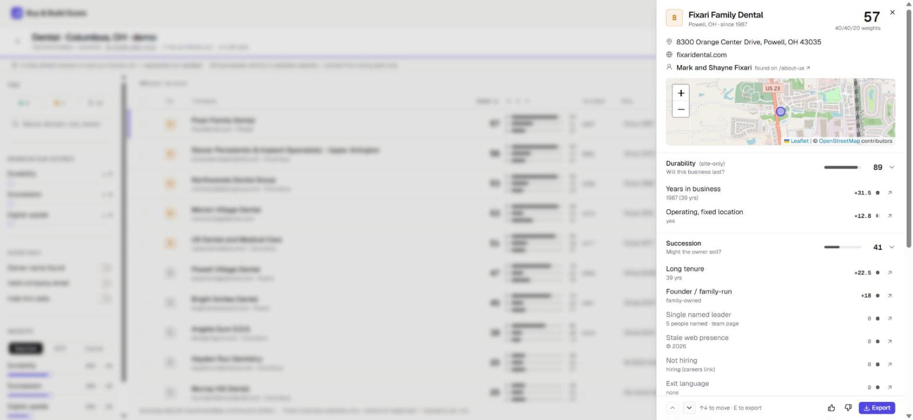
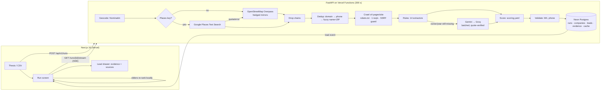

# Buy & Build Score

**Spend SaaSquatch credits only on owners who'll actually sell.**

Buy & Build Score is a sourcing add-on for [SaaSquatch Leads](https://saasquatchleads.com). Give it an industry and a city (or your SaaSquatch CSV export) and it finds owner-operated small businesses, reads their public websites politely, and ranks them as acquisition targets on three explainable sub-scores: **Durability** (will it last?), **Succession likelihood** (might the owner sell?) and **Digital upside gap** (how much can a buyer improve, fast?). Every point links to the page, snippet or API field that earned it; a signal we can't find scores zero and lowers coverage instead of being guessed. It sits between SaaSquatch's Discover and Enrich steps, so enrichment credits (~$0.39 each on Silver) go only to the leads worth a call — and the whole thing runs on free tiers for $0.



- **Live demo:** `https://<your-vercel-app>.vercel.app/runs/demo` (no keys needed)
- **API docs:** `https://<your-vercel-app>.vercel.app/api/v1/docs`

---

## How it works



**The run is the stream.** `GET /api/v1/runs/{id}/stream` executes the pipeline inside the SSE response: each company is crawled, extracted, scored, saved and streamed as soon as it finishes. There is no queue or worker. At 280 s (under Vercel's 300 s cap) it stops cleanly with a `resume` event and the browser reopens the stream, which continues with only the unscored companies. A finished run replays from the database; a second tab on a running run follows it instead of crawling twice (a lease column, because Neon's pooler can't hold advisory locks).

**Caching (no Redis):** a per-instance TTL cache in front of one Postgres `cache` table — discovery 24 h, crawled pages 7 days (compressed), robots.txt 24 h, MX 7 days, LLM answers 30 days, geocodes 30 days, rate-limit counters 1 h. Re-running a thesis within a week makes zero website requests.

## Scoring

Three additive sub-scores, each 0–100, from observable signals only. Points are multiplied by evidence confidence (rule 0.9, HTTP 0.95, OSM 0.85, Google Places 0.95, LLM 0.7). All thresholds live in [`api/app/scoring.yaml`](api/app/scoring.yaml).

**Durability — will this business last?**

| Signal | Detection | Points |
| --- | --- | --- |
| Years in business | schema.org `foundingDate`, "since / est. / founded 19xx", OSM `start_date`, LLM fallback | ≥25y 35 · 15–24 28 · 8–14 18 · 3–7 8 |
| Review volume* | Places `userRatingCount` | ≥200 25 · 50–199 18 · 15–49 10 · <15 3 |
| Rating* | Places `rating` | ≥4.5 15 · 4.0–4.4 10 · 3.5–3.9 4 |
| Recent activity* | newest Places review | ≤90 d 10 · ≤365 d 5 |
| Operating, fixed location | street address (OSM / Places / site schema.org) + website responds | 15 |

\* Places mode only. Without a Places key, durability is re-normalised over the 50 points available and labelled **durability (site-only)**.

**Succession likelihood — might the owner sell?** (business level only; never a person's age)

| Signal | Detection | Points |
| --- | --- | --- |
| Long tenure | founding year | ≥25y 25 · 15–24 15 |
| Founder / family-run | "family-owned", "second generation", "& Sons"…; owner surname in business name | 20 |
| Single leader | exactly one person named, no team page | 15 |
| Stale web presence | footer © year | ≤ now−3 15 · now−2 8 |
| Not hiring | no careers page / "we're hiring" | 10 |
| Exit language | "retiring", "for sale", "succession"… near owner/business, with negation and service guards | 15 |

**Digital upside gap — how much can a buyer improve fast?** (points for *absence*)

| Signal | Detection | Points |
| --- | --- | --- |
| No online booking / quote | no Calendly, Jobber, Housecall Pro, ServiceTitan, Square… and no quote/booking form | 20 |
| Slow site | PageSpeed mobile score (with a key): <50 15 · 50–79 8; otherwise TTFB > 1.5 s or HTML > 3 MB | 15 |
| No live chat | no Intercom, Drift, Tidio, tawk.to, Podium… | 10 |
| No HTTPS / bad cert | final URL scheme, TLS verification | 10 |
| Not mobile-ready | no `<meta name=viewport>` | 10 |
| Outdated stack | jQuery < 3, WordPress < 6.0, Flash, table layout, old Bootstrap | 10 |
| No analytics | no GA4 / GTM / Meta Pixel / Plausible… | 10 |
| Phone-only CTA | `tel:` link, no form, no `mailto:` | 10 |
| No social links | no Facebook / Instagram / LinkedIn / Yelp… | 5 |

**Composite and tiers.** `C = (wD·D + wS·S + wU·U) / (wD + wS + wU)`, rounded half-up identically in Python and the browser. Presets: **Searcher** 40/40/20, **SDR** 25/10/65, **Caprae** 35/30/35. Tier **A ≥ 70**, **B 50–69**, **C < 50**. Guardrails cap an A at B when durability < 30 ("upside on a failing business isn't upside") or coverage < 40% ("thin data"). Tier is always shown as a letter, never colour alone.

**Grounded LLM.** Only when rules miss the owner or founding year, up to 6,000 chars of about/team text per company go to Gemini Flash (Groq fallback), 5 companies per call. Page text is wrapped as untrusted data. Every non-null field must appear verbatim in the returned `evidence_quote`, and the quote must be a substring of the input — otherwise it's discarded. Measured on a live run: 5 LLM calls for 59 companies.

## What's measured

| | Result |
| --- | --- |
| Tests | 142 API unit tests (11 hand-written SMB fixtures with expected evidence, scoring math, dedup, crawler/SSRF/robots, LLM guard, HubSpot payload, PageSpeed) + 6 Postgres integration tests (SSE order, persistence, replay, ranked list, CSV, demo, rate limit) + 11 vitest |
| Demo run | Dental, Columbus OH: 60 discovered → 7 chains dropped → 59 scored in 163 s (from India against Neon in Ohio; Vercel in `cle1` is next door) |
| Live auto-repair run | 20 discovered → 19 scored, done in 140 s; B-tier: Joe's Service Station (since 1948, family-owned), Brown's Alignment (1981, family-owned), C.A.R.S @ Polaris (1962) |
| Tier-A precision | _TODO: hand-label 30 demo leads A/B/C and report agreement here._ |

**Honest limits of OSM-only mode.** OpenStreetMap coverage of small trades is uneven (Columbus, 40 km: dental 60 listings / 30 with websites; HVAC 15 / 9). Businesses without a readable website score from listing data only and are marked *thin data*. A Google Places key adds ratings, review counts and recency — 40 more durability points of signal.

## Run it locally

Requirements: Python 3.12 + [uv](https://docs.astral.sh/uv/), Node 20.9+ + pnpm, and either Docker (local Postgres) or a free [Neon](https://neon.com) database.

```bash
cp .env.example .env              # set DATABASE_URL; every other key is optional
docker compose up -d db           # or paste your Neon connection string into .env

cd api
uv sync
uv run alembic upgrade head
uv run uvicorn app.main:app --reload --port 8000      # http://localhost:8000/api/v1/docs

cd ../web
pnpm i
echo NEXT_PUBLIC_STREAM_ORIGIN=http://localhost:8000 > .env.local   # SSE straight to the API in dev
pnpm dev                                              # http://localhost:3000
```

`DATABASE_URL` can be pasted exactly as Neon gives it (`postgresql://…?sslmode=require&channel_binding=require`); it's normalised for asyncpg.

Checks: `uv run pytest -q`, `uv run ruff check . && uv run mypy app` (API); `pnpm test`, `pnpm lint`, `pnpm typecheck` (web). Integration tests run when `TEST_DATABASE_URL` points at a disposable database — they truncate it.

Refresh the bundled demo from any finished run: `uv run python scripts/export_demo.py <run_id>`.

## Deploy ($0, no card)

1. **Neon Free** → create a project in **AWS us-east-2** → copy the *pooled* connection string.
2. **GitHub** → push this repo (public, so Actions minutes are free). Add repo secret `DATABASE_URL` = the Neon string; CI runs `alembic upgrade head` against it on every push to `main`.
3. **Vercel Hobby** → *Add New Project* → import the repo. `vercel.json` defines two Services (`web` = Next.js at `/`, `api` = FastAPI at `/api/*`, 300 s max duration).
   - Settings → Functions → **Function Region: `cle1` (Cleveland)**, next to Neon us-east-2.
   - Settings → Environment Variables: `DATABASE_URL` (required), optionally `GEMINI_API_KEY`, `GROQ_API_KEY`, `GOOGLE_PLACES_API_KEY`, `HUBSPOT_TOKEN`, plus `ALLOWED_ORIGINS=https://<app>.vercel.app`, `PUBLIC_APP_URL=https://<app>.vercel.app`, `CRAWL_USER_AGENT="BuyBuildScoreBot/0.1 (+https://github.com/<you>/buy-build-score; contact: <email>)"`.
4. Deploy. Smoke test: `/runs/demo` loads, `/api/v1/healthz` returns `{"ok":true,"db":true}`, `/api/v1/docs` renders, one 20-result run completes.

**Optional Google Places at $0:** it needs a billing account. In Google Cloud Console cap *Places API (New)* at 30 requests/day (≤ 930/month, under the 1,000 free) and add a $1 budget alert; capped requests are refused, never billed.

| Free tier | Limit that matters | Use per 60-business run |
| --- | --- | --- |
| Vercel Hobby | 300 s functions, 4 active-CPU h/month, 1M invocations | 1 stream (I/O-bound) + a few reads |
| Neon Free | 1 GB storage/project, 100 CU-h/month, autosuspend after 5 min idle | < 2 CU-min |
| Overpass | fair use (~100 queries/day) | 1 query, cached 24 h |
| Gemini / Groq | free RPM/RPD caps | ~5 calls, cached 30 days |

## Ethics and limits

- **Public business data only.** OpenStreetMap (ODbL, attributed), optional Google Places (licensed API, attribution shown), public company websites, DNS. No LinkedIn, no login walls, no CAPTCHA solving, no proxy rotation.
- **Polite crawling.** robots.txt honoured (5xx/403 robots = don't crawl); an identifiable User-Agent with the repo URL; 1 request/second per host; at most 4 pages per site; 7-day cache to avoid repeat visits. A site that blocks bots is labelled, not bypassed.
- **Personal data minimisation.** Only a publicly listed owner name/title and company-level contact info. No personal emails or phones guessed or permuted. No SMTP mailbox probing — email validity is syntax + MX only. **No age estimation, ever.**
- **Security.** SSRF guard on every outbound fetch and redirect hop (private, loopback, link-local, CGNAT, `169.254.169.254`, non-http(s) all blocked). Secrets server-side only. Postgres-backed rate limits (10 runs/hour/IP, 60 requests/minute/IP). CSV export neutralises spreadsheet formulas. LLM output is quote-verified.
- **Retention.** Crawl cache 7 days; cache rows expire automatically. Nightly purge of old runs and a `DELETE /companies/{domain}` removal endpoint are roadmap (P2).
- **Compliance note (not legal advice).** Outreach you send is subject to CAN-SPAM; business contact data under GDPR/CCPA relies on legitimate interest — honour opt-outs.
- **Known limits.** JS-only sites aren't rendered (no headless browser on the free function), OSM coverage varies by trade and town, owner names come from the site's own words and may be stale, and Gemini's free tier can be unavailable (the run falls back to Groq, then rules-only).

## Roadmap (P2)

Per-lead thumbs up/down already stored → learn weights from it · scheduled re-scans with change alerts ("new *for sale* mention", "site went dark") · owner opener drafting grounded in evidence · headless rendering for JS sites · auth, workspaces and metering tied to SaaSquatch credits.

## Repo map

```
api/   FastAPI app (app/), Alembic migrations, tests/ (fixtures/*.html + *.expected.json), scripts/export_demo.py
web/   Next.js 16 app (app/, components/, lib/score.ts mirrors the API scorer)
data/  demo_run.json — bundled demo
DECISIONS.md  every ambiguity resolved, one line each
TIMELOG.md    build time per milestone
```

## Time log

See [TIMELOG.md](TIMELOG.md). Built milestone by milestone with Claude Code (AI-assisted); spec/research writing and the video are excluded.
