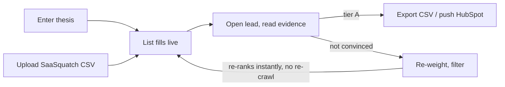
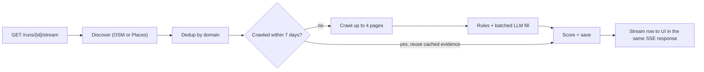

# Buy & Build Score — Product & Technical Spec

Oct 11, 2026 · Shreyas Manchanda

> Build companions: `CLAUDE.md` (rules, stack pins; overrides this file on conflict), `TASKS.md` (build order), `api/app/scoring.yaml`, `api/app/fingerprints.yaml`, `api/app/osm_tags.yaml`, `api/app/prompts/extract.md`.

## Summary

Buy & Build Score is a sourcing add-on for SaaSquatch Leads that ranks owner-operated small businesses by how likely they are to be a good acquisition: durable, likely to sell, and full of fixable digital upside. Every score is explained by evidence with a source URL. It sits between SaaSquatch's Discover and Enrich steps, so users spend enrichment credits only on A-tier targets.

- **For:** independent searchers and acquisition entrepreneurs first; SDRs doing owner outreach second.
- **Input:** an industry + geography thesis, or a CSV exported from SaaSquatch.
- **Output:** a ranked, deduplicated list with three sub-scores, evidence, verified contact status, a drafted owner opener, and one-click export to CSV or HubSpot.
- **North-star metric:** share of exported leads that become a first conversation with the owner (proxy in the demo: % of leads landing in tier A that a human reviewer agrees with).
- **Build budget:** 5 hours, Quality First approach (one feature done deeply). Runs entirely on free tiers: $0, no credit card needed (Google Places is an optional upgrade).

## Goals, non-goals, success metrics

The goal is a trustworthy shortlist, not a bigger list. Anything that adds rows without adding confidence is out of scope.

**Goals**

1. Rank up to 60 discovered businesses (180 with keyword expansion) into A/B/C tiers in under 90 seconds for a cold run.
2. Explain every score: each contributing point links to the page, snippet, or API field that produced it.
3. Let users retune what "good" means (searcher vs SDR presets, weight sliders) without re-crawling.
4. Drop leads into existing workflows: CSV in SaaSquatch's column format and HubSpot Companies.
5. Collect data ethically: robots.txt, rate limits, no SMTP probing, no login-walled sources.

**Non-goals (this build)**

- Personal contact enrichment (emails/phones of individuals) — SaaSquatch already sells this per credit.
- LinkedIn scraping — against LinkedIn's terms and brittle.
- Revenue estimation — SaaSquatch has it; we consume it from CSV if present.
- Auth, teams, billing — single-user demo; noted as production work.
- Outbound sending — we draft, the user sends.

**Success metrics**

| Metric | Target (demo) | How measured |
| --- | --- | --- |
| Cold run time, 60 businesses | ≤ 90 s p50 | Job `started_at` → `finished_at` |
| Warm re-run (cached) | ≤ 5 s | Same thesis, cache hit |
| Leads with ≥ 1 evidence item per sub-score | ≥ 80% | Count in DB |
| Tier-A precision vs manual review | ≥ 70% on a 30-lead sample | Hand-labeled fixture set |
| Duplicate rows after dedup | 0 on fixture set | Unit test |
| Crawl success rate (got ≥ 1 page) | ≥ 85% | `crawl_status` |

## Users and jobs-to-be-done

The primary user is a searcher with 12–24 months of runway who needs to find one owner willing to sell. Every design choice optimizes for their time.

| User | Job to be done | What they need from us | Default preset |
| --- | --- | --- | --- |
| Independent / funded searcher | "Find founder-owned businesses in my thesis whose owner may want out, and that I could grow." | Succession + durability signals, evidence they can show investors, owner name | Searcher: durability 40, succession 40, upside 20 |
| SDR / BD rep selling to SMBs | "Find businesses that need what I sell and will pick up the phone." | Digital-gap signals, phone validity, a call opener | SDR: durability 25, succession 10, upside 65 |
| Caprae deal team / portfolio ops | "Spot add-on acquisitions and portfolio AI-upgrade opportunities." | Upside gap mapped to concrete fixes, HubSpot sync | Caprae: durability 35, succession 30, upside 35 |

**Key user stories (P0)**

- As a searcher, I enter "HVAC, Columbus OH" and get a ranked list without configuring anything.
- As a searcher, I click any score and see exactly why, with links.
- As a searcher, I upload my SaaSquatch CSV and get the same scoring on my existing list.
- As any user, I export A-tier leads to CSV or HubSpot in one click, without duplicates.

## User flow

A user goes from a thesis (or an existing SaaSquatch CSV) to exported A-tier leads in one sitting, with a tight loop for re-weighting when the ranking doesn't match their judgment.



Re-weighting never re-crawls: sliders recompute the composite from stored sub-scores, so the loop costs nothing.

## Functional requirements

P0 ships in the 5-hour build; P1 ships if time allows; P2 is documented as roadmap in the README.

| ID | Requirement | Priority |
| --- | --- | --- |
| FR-1 | Create a run from a thesis: industry keyword (free text), location (city/state or lat-lng + radius km), max results (20/40/60, default 60 — Google Places caps one query at 60; "Expand" adds up to 2 related keywords for 180 max) | P0 |
| FR-2 | Create a run from CSV upload (≤ 2 MB, ≤ 500 rows); required column: `website` or `company_name`+`city`; SaaSquatch export headers auto-mapped | P0 |
| FR-3 | Discover businesses via OpenStreetMap Overpass by default (free, no key); use Google Places Text Search (New) when a key is set, for ratings and review counts; fall back to OSM on quota errors | P0 |
| FR-4 | Deduplicate by normalized domain, then E.164 phone, then fuzzy name + postcode (token-set ratio ≥ 90) | P0 |
| FR-5 | Crawl homepage + up to 3 internal pages matching about/contact/team/history; obey robots.txt; 1 req/s per domain | P0 |
| FR-6 | Extract signals with deterministic rules first, LLM (Gemini Flash free tier, Groq fallback; JSON output, batched 5 companies per call) only for owner name, founding year, and service list when rules miss | P0 |
| FR-7 | Compute durability, succession, and upside sub-scores (0–100) plus a weighted composite and tier (A ≥ 70, B 50–69, C < 50) | P0 |
| FR-8 | Store every signal as evidence: signal key, value, points, source URL, snippet (≤ 200 chars), confidence 0–1 | P0 |
| FR-9 | Stream run progress to the UI via SSE (discovered, crawled, scored counts; per-lead updates) | P0 |
| FR-10 | Ranked table: sort by composite or any sub-score; filter by tier, sub-score range, has-owner-name, crawl status | P0 |
| FR-11 | Lead drawer: three sub-score breakdowns, evidence chips linking to source, contact status, map pin | P0 |
| FR-12 | Re-weight scores client-side with presets and sliders; composite + tier recompute instantly, no API call | P0 |
| FR-13 | Validate contact data: company email syntax + MX record, phone parse/format, website HTTP status + HTTPS | P0 |
| FR-14 | Export selected or filtered leads to CSV (SaaSquatch-compatible columns + scores + top 3 evidence) | P0 |
| FR-15 | Push selected leads to HubSpot Companies; upsert on domain; write scores to custom properties | P1 |
| FR-16 | Generate an owner opener (email ≤ 120 words + 2-line call opener) grounded only in stored evidence | P1 |
| FR-17 | Plain-English thesis ("landscaping cos in Austin around 20 yrs old") parsed into FR-1 fields | P1 |
| FR-18 | Cached demo run bundled in the repo; works with zero API keys | P0 |
| FR-19 | Per-lead feedback (thumbs up/down on tier) stored for future weight learning | P2 |
| FR-20 | Scheduled re-scan of saved lists with change alerts (e.g. website went dark, new "for sale" mention) | P2 |
| FR-21 | Auth, workspaces, usage metering tied to SaaSquatch credits | P2 |

## Scoring model

Three additive sub-scores, each capped at 100 points, built only from observable signals. A missing signal scores 0 and lowers the lead's coverage; it never gets guessed. All thresholds live in one `scoring.yaml` so they can be tuned without code changes.

### Durability (D) — will this business last?

| Signal | Detection | Points |
| --- | --- | --- |
| Years in business | "since / est. / founded 19xx" regex, schema.org `foundingDate`, LLM fallback; WHOIS domain age as weak fallback (confidence 0.4) | ≥25y: 35 · 15–24: 28 · 8–14: 18 · 3–7: 8 · <3: 0 |
| Review volume | Places `userRatingCount` | ≥200: 25 · 50–199: 18 · 15–49: 10 · <15: 3 |
| Rating | Places `rating` | ≥4.5: 15 · 4.0–4.4: 10 · 3.5–3.9: 4 · <3.5: 0 |
| Recent activity | Newest Places review `publishTime` | ≤90 days: 10 · ≤365: 5 · older: 0 |
| Operating, fixed location | `businessStatus = OPERATIONAL` and a street address | 15 |

**Free mode (OSM discovery, no Places key):** review volume, rating and recent activity don't exist, and OSM has no business status, so "operating" becomes "has a street address and the website responds". Durability is re-normalized over the signals available (max 50 → scaled to 100), and the UI labels it "durability (site-only)". With a Places key, the `reviews` field puts calls on the Enterprise + Atmosphere SKU, which has the same 1,000 free calls/month.

### Succession likelihood (S) — might the owner sell?

| Signal | Detection | Points |
| --- | --- | --- |
| Long tenure | Founding year as above | ≥25y: 25 · 15–24: 15 |
| Founder/family-run | "family-owned", "second generation", "& Sons"; owner surname appears in business name | 20 |
| Single leader | Only one person named on site, no team/leadership page | 15 |
| Stale web presence | Footer copyright year | ≤ current−3: 15 · current−2: 8 |
| Not hiring | No careers/jobs page or "we're hiring" text | 10 |
| Explicit exit language | "retiring", "for sale", "succession", "new ownership", "transition" within 100 chars of "owner"/"business" | 15 |

Succession is scored at the business level only. The system never estimates or stores a person's age.

### Digital upside gap (U) — how much can a buyer improve fast?

| Signal (absence = points) | Detection | Points |
| --- | --- | --- |
| No online booking/quote | No Calendly, Jobber, Housecall Pro, ServiceTitan, Square Appointments scripts; no form with "quote/estimate/book" | 20 |
| Slow site | PageSpeed Insights mobile perf (P1); fallback TTFB > 1.5 s or HTML+assets > 3 MB | <50: 15 · 50–79: 8 |
| No live chat | No Intercom, Drift, Tidio, tawk.to, LiveChat, HubSpot chat script | 10 |
| No HTTPS / bad cert | Final URL scheme, TLS handshake | 10 |
| Not mobile-ready | No `<meta name=viewport>` | 10 |
| Outdated stack | jQuery < 3, WordPress generator < 6.0, table layouts, Flash/`.swf` | 10 |
| No analytics | No GA4/GTM/Meta Pixel tags | 10 |
| Phone-only CTA | `tel:` links, no form, no mailto | 10 |
| No social links | No Facebook/Instagram/LinkedIn/Yelp links | 5 |

### Composite, tiers and guardrails

```latex
C = \frac{w_D \cdot D + w_S \cdot S + w_U \cdot U}{w_D + w_S + w_U}
```

- Tiers: A ≥ 70, B 50–69, C < 50.
- **Durability floor:** if D < 30, tier is capped at B. Upside on a failing business isn't upside.
- **Coverage:** share of the 20 signals with a known value. Coverage < 40% → badge "thin data", tier capped at B.
- **Confidence:** each evidence item carries 0–1 (rule hit 0.9, LLM 0.7, WHOIS 0.4). Points are multiplied by confidence, so weak evidence counts less.
- Weights default to the preset (see Users); recompute runs in the browser from stored sub-scores.

## System architecture and run pipeline

A run is one streaming request: `GET /runs/{id}/stream` on the FastAPI service (a Vercel Function, 300 s cap) discovers businesses, then pushes each company through crawl → extract → score independently and streams its row the moment it's done. Components: Next.js 16 and FastAPI in one Vercel Hobby project → Neon Postgres (data + cache), OpenStreetMap Overpass or Google Places, company websites, Gemini/Groq, HubSpot.



Because the run lives inside the streaming response, there's no queue, worker or pub/sub to operate. A company crawled in the last 7 days skips straight to scoring with its stored evidence; a run that nears the 280 s guard ends with a `resume` event and picks up where it stopped.

## Data model

Five tables in Neon Postgres 17 (Free plan): a run owns leads, a lead owns evidence. Companies are keyed by normalized domain so the same business found in two runs reuses its crawl. Migrations via Alembic; access via SQLAlchemy 2.0 async + asyncpg.

```sql
CREATE TABLE runs (
  id            uuid PRIMARY KEY DEFAULT gen_random_uuid(),
  source        text NOT NULL CHECK (source IN ('thesis','csv','demo')),
  query         jsonb NOT NULL,          -- {industry, location, radius_km, max_results}
  preset        text NOT NULL DEFAULT 'searcher',
  status        text NOT NULL DEFAULT 'queued'
                CHECK (status IN ('queued','discovering','crawling','scoring','done','failed')),
  counts        jsonb NOT NULL DEFAULT '{}',  -- {discovered, deduped, crawled, scored, failed}
  error         text,
  created_at    timestamptz NOT NULL DEFAULT now(),
  finished_at   timestamptz
);

CREATE TABLE companies (
  id              uuid PRIMARY KEY DEFAULT gen_random_uuid(),
  domain          text UNIQUE,            -- normalized: lowercase, no www, no path
  name            text NOT NULL,
  phone_e164      text,
  address         text,
  city            text, region text, postcode text, country text,
  lat             double precision, lng double precision,
  place_id        text UNIQUE,            -- Google Places id (the only Places field kept past 30 days)
  osm_id          text UNIQUE,            -- e.g. 'node/123456' when found via Overpass
  rating          numeric(2,1),
  review_count    int,
  founded_year    int,
  owner_name      text,
  crawl_status    text CHECK (crawl_status IN ('ok','partial','blocked_robots','unreachable','no_site')),
  crawled_at      timestamptz,
  raw             jsonb NOT NULL DEFAULT '{}'  -- extracted page facts, tech fingerprints
);
CREATE INDEX companies_phone_idx ON companies (phone_e164);
CREATE INDEX companies_name_trgm ON companies USING gin (name gin_trgm_ops);

CREATE TABLE leads (
  id             uuid PRIMARY KEY DEFAULT gen_random_uuid(),
  run_id         uuid NOT NULL REFERENCES runs(id) ON DELETE CASCADE,
  company_id     uuid NOT NULL REFERENCES companies(id),
  durability     smallint NOT NULL CHECK (durability BETWEEN 0 AND 100),
  succession     smallint NOT NULL CHECK (succession BETWEEN 0 AND 100),
  upside         smallint NOT NULL CHECK (upside BETWEEN 0 AND 100),
  coverage       numeric(3,2) NOT NULL,   -- 0.00–1.00
  email_status   text CHECK (email_status IN ('valid_mx','no_mx','invalid','none')),
  phone_valid    boolean,
  feedback       smallint,                -- -1 / 1, P2
  exported_at    timestamptz,
  hubspot_id     text,
  UNIQUE (run_id, company_id)
);
CREATE INDEX leads_run_idx ON leads (run_id);

CREATE TABLE evidence (
  id          bigserial PRIMARY KEY,
  company_id  uuid NOT NULL REFERENCES companies(id) ON DELETE CASCADE,
  dimension   text NOT NULL CHECK (dimension IN ('durability','succession','upside')),
  signal      text NOT NULL,             -- e.g. 'years_in_business', 'no_booking'
  value       text,                      -- e.g. '1987', 'copyright 2019'
  points      numeric(4,1) NOT NULL,
  confidence  numeric(3,2) NOT NULL,
  source_url  text,
  snippet     varchar(200),
  extractor   text NOT NULL CHECK (extractor IN ('rule','llm','places','whois','http')),
  UNIQUE (company_id, signal)
);
CREATE INDEX evidence_company_idx ON evidence (company_id);

CREATE TABLE cache (                     -- replaces Redis
  key         text PRIMARY KEY,          -- e.g. 'crawl:buckeyehvac.com'
  value       jsonb NOT NULL,
  expires_at  timestamptz NOT NULL
);
CREATE INDEX cache_expires_idx ON cache (expires_at);  -- purge: DELETE ... WHERE expires_at < now()
```

Design notes:

- Sub-scores are stored per lead; the composite and tier are **not** stored because they depend on user weights. They're computed in SQL for sorting (`ORDER BY (wd*durability + ws*succession + wu*upside)`) and in the browser for sliders.
- Evidence belongs to the company, not the run, so a re-run within 7 days costs nothing.
- `pg_trgm` extension powers fuzzy-name dedup.

## API spec

REST over JSON at `/api/v1`, plus one SSE stream per run. FastAPI generates OpenAPI at `/docs`, which doubles as the "API demonstration" the handbook asks for.

| Method | Path | Purpose | Returns |
| --- | --- | --- | --- |
| POST | `/runs` | Create a run from a thesis (crawling starts when the stream opens) | `202` `{run_id}` |
| POST | `/runs/csv` | Start a run from CSV (multipart `file`) | `202` `{run_id, rows_accepted, rows_rejected}` |
| POST | `/runs/demo` | Load the bundled cached run | `200` `{run_id}` |
| GET | `/runs/{id}` | Run status and counts | `RunOut` |
| GET | `/runs/{id}/stream` | Runs the pipeline while streaming SSE; replays stored rows if done, resumes if partial | `text/event-stream` |
| GET | `/runs/{id}/leads` | Ranked leads; query `wd, ws, wu, tier, min_d, min_s, min_u, q, sort, page, page_size≤100` | `{items: LeadOut[], total}` |
| GET | `/leads/{id}` | One lead with full evidence | `LeadDetail` |
| POST | `/leads/{id}/opener` | Draft owner email + call opener (P1) | `{email, call_opener, evidence_ids}` |
| POST | `/leads/{id}/feedback` | `{vote: 1 \| -1}` (P2) | `204` |
| POST | `/export/csv` | `{lead_ids[]}` or `{run_id, filters}` | `text/csv` download |
| POST | `/export/hubspot` | `{lead_ids[]}` (P1) | `{created, updated, failed[]}` |
| POST | `/parse-thesis` | `{text}` → FR-1 fields (P1) | `ThesisIn` |
| GET | `/healthz` | Liveness + DB ping | `{ok, db}` |

**Core schemas (Pydantic v2)**

```json
// POST /runs  — ThesisIn
{ "industry": "hvac", "location": "Columbus, OH", "radius_km": 40,
  "max_results": 100, "preset": "searcher" }

// LeadOut (list row)
{ "id": "uuid", "name": "Buckeye Heating & Cooling", "domain": "buckeyehvac.com",
  "city": "Columbus", "phone": "+16145550123", "founded_year": 1984,
  "scores": { "durability": 86, "succession": 72, "upside": 65, "composite": 76, "tier": "A" },
  "coverage": 0.85, "top_evidence": ["Since 1984", "No online booking", "© 2019 footer"],
  "email_status": "valid_mx", "phone_valid": true, "crawl_status": "ok" }

// LeadDetail adds
{ "evidence": [ { "dimension": "succession", "signal": "stale_copyright",
    "value": "2019", "points": 15, "confidence": 0.9,
    "source_url": "https://buckeyehvac.com/", "snippet": "© 2019 Buckeye Heating…",
    "extractor": "rule" } ],
  "owner_name": "Tom Reilly", "address": "…", "lat": 39.96, "lng": -83.0 }
```

**SSE events** (`event:` name, JSON `data:`)

- `status` — `{status, counts}` on every phase change
- `lead` — `LeadOut` as each lead finishes scoring (UI inserts the row live)
- `warning` — `{company, reason}` e.g. robots-blocked, timeout
- `done` — `{counts, duration_ms}`; `error` — `{message}`
- Heartbeat comment every 15 s to keep proxies open.

**Errors** — RFC 7807 `application/problem+json`: `422` validation, `413` CSV too large, `429` rate limit (10 runs/hour/IP via a Postgres counter), `502` upstream (Places/LLM) with `retry_after`.

## Crawling, extraction and validation

Rules first, LLM last: deterministic extractors handle \~80% of signals for free and are testable; the LLM fills only owner name, founding year, and services when rules miss.

**Crawler (httpx.AsyncClient, HTTP/2)**

- Concurrency: global semaphore 20; per-domain 1 request/second; max 4 pages per domain (home + 3).
- Page selection: internal links whose path or anchor text matches `about|our-story|history|team|contact|staff|careers|jobs`, ranked by match, top 3.
- Timeouts: connect 5 s, read 10 s, total per domain 25 s. Retries: 2 with exponential backoff (0.5 s, 1.5 s) on 429/5xx/timeouts; respect `Retry-After`.
- robots.txt fetched once per domain (cached 24 h); disallowed paths skipped; fully disallowed → `crawl_status = blocked_robots`, scored from Places data only.
- User-Agent: `BuyBuildScoreBot/0.1 (+https://<repo-url>; contact: <email>)` — honest, identifiable.
- Max body 3 MB; only `text/html`. Parse with selectolax (Lexbor) — \~10× faster than BeautifulSoup.
- JS-rendered fallback: if visible text < 300 chars and a `<div id=root|app|__next>` is present, re-fetch homepage with Playwright (Chromium, 15 s cap). P2: headless Chromium doesn't fit the free Vercel Functions deploy, so it's skipped there and documented as a production add-on.
- Resilience to site changes: no site-specific selectors; signals come from text patterns, `<meta>`, schema.org JSON-LD, script `src` fingerprints, and link patterns.

**Deterministic extractors** (`extractors/*.py`, one pure function each: `(pages) -> list[Evidence]`)

- `founded_year`: JSON-LD `foundingDate`; regex `(since|est\.?|established|founded|serving .* since)\s+(19[2-9]\d|20[0-2]\d)`; reject years > current or < 1900.
- `copyright_year`: last 4-digit year near `©|&copy;|copyright` in the footer region.
- `family_owned`, `exit_language`, `hiring`: keyword lists with negation guard ("not for sale").
- `tech_fingerprints`: script/link `src` and inline-snippet matches against a 40-entry table (booking, chat, analytics, CMS + version, jQuery version).
- `mobile`, `https`, `ttfb_ms`, `page_bytes`, `social_links`, `tel_only_cta`.
- `people_named`: count of distinct person names on team/about pages (spaCy `en_core_web_sm` PERSON entities, P1; regex on "Owner/President/Founder: Name" for P0).

**LLM extraction contract (Gemini Flash free tier with Groq fallback, `response_mime_type=application/json`, temperature 0)**

- Called only if `owner_name` or `founded_year` is still null after rules. Input: up to 6,000 chars of cleaned about/team text per company, batched up to 5 companies per call; output is a JSON array keyed by company id.
- Output schema: `{owner_name: str|null, owner_title: str|null, founded_year: int|null, services: str[], evidence_quote: str}`.
- Guard: every non-null field must appear verbatim (case-insensitive) in `evidence_quote`, and `evidence_quote` must be a substring of the input. Otherwise discarded. This kills hallucinated owners.
- Confidence 0.7; cached by `sha256(input_text)`.

**Validation**

- Website: final status 2xx/3xx, HTTPS, cert valid (httpx verify).
- Email (company-level only, scraped from `mailto:` or contact page): `email-validator` syntax + dnspython MX lookup (2 s timeout, cached 7 days per domain). No SMTP RCPT probing.
- Phone: `phonenumbers` parse with region from address → E.164; `is_valid_number`.
- Dedup: normalize domain (`tldextract`), phone (E.164), name (lowercase, strip LLC/Inc/Co/&/punctuation) → match order domain → phone → `rapidfuzz.token_set_ratio ≥ 90` + same postcode. Merge keeps the most complete record and lists `merged_from`.

## Caching, performance and cost

A 60-business cold run fits in \~60–90 seconds because crawling is parallel and network-bound; a warm re-run is a few Postgres reads. All caching lives in one Neon table plus an in-function memory cache, so there is no Redis to run or pay for.

**Cache design** — table `cache(key text primary key, value jsonb, expires_at timestamptz)`, read-through via `cache.py`; a 2-level lookup checks a per-instance `cachetools.TTLCache` first (Vercel Fluid compute reuses warm instances), then Postgres.

| Key prefix | Value | TTL | Why |
| --- | --- | --- | --- |
| `osm:` / `places:` + sha1(query) | Discovery results | 24 h | Respects Overpass fair use; protects the Places free quota |
| `crawl:{domain}` | Cleaned page text + fingerprints | 7 d | Skip re-crawl across runs |
| `robots:{domain}` | Parsed robots.txt | 24 h | One fetch per domain |
| `mx:{domain}` | MX result | 7 d | DNS lookups add up |
| `llm:` + sha256(input) | LLM JSON | 30 d | Same input, same output at temp 0; saves free-tier calls |
| `geo:` + sha1(location) | Geocode result | 30 d | Nominatim allows 1 req/s |
| `rl:{ip}:{yyyymmddhh}` | Run counter | 1 h | 10 runs/hour/IP |

**Latency budget, 60 businesses, cold**

| Stage | Budget | How |
| --- | --- | --- |
| Geocode + discover | 3–6 s | Overpass one query, or 3 Places pages × 20 |
| Dedup | < 0.5 s | In-memory + one trigram query |
| Crawl (≤ 4 pages × 60 domains) | 45 s | 20 concurrent, 25 s per-domain cap |
| Extract + LLM gaps | 10 s | \~20 companies need help → 4 batched calls of 5 companies each, overlapping the crawl |
| Score + write | 2 s | Batched `INSERT … ON CONFLICT` |
| **Total p50** | **≤ 90 s** | First row streams by \~8 s; hard stop at 280 s (under Vercel's 300 s cap) with a "resume" event |

**LLM batching (free-tier fit):** one call carries up to 5 companies' cleaned about/team text (\~1,500 tokens each) and returns a JSON array. That keeps a 60-company run at ≤ 4–6 calls, under a 10 RPM free cap. If Gemini returns 429, the same prompt goes to Groq; if both are exhausted, the run continues rules-only and marks those fields "not found".

**Frontend performance:** TanStack Table with row virtualization (smooth at 500 rows); slider re-weighting recomputes in a `useMemo` over stored sub-scores; the demo run is a static JSON served from Vercel's CDN.

**Cost per run: $0**

| Item | Free allowance | Usage per 60-business run | Runs/month before any limit |
| --- | --- | --- | --- |
| Vercel active CPU | 4 hrs/month | \~20–40 CPU-s (estimate; measure in the dashboard) | \~360+ |
| Vercel invocations | 1M/month | \~70 (stream + lead/detail reads) | \~14,000 |
| Neon compute | 100 CU-hours/month | < 2 CU-minutes (autosuspends after 5 min) | \~3,000 |
| Google Places (optional) | 1,000 Enterprise calls/month | 3 calls | \~300 (capped at 30/day) |
| Overpass (default) | \~100 queries/day for regular use | 1 query (cached 24 h) | \~100/day |
| Gemini / Groq | Free-tier RPD | 4–6 calls | Hundreds |

For the business case in the video: SaaSquatch charges \~$0.39 per enriched lead on Silver ($49 / 125). Scoring before enriching means credits go only to A-tier leads.

## UI spec

Three screens and one drawer; the user is never more than two clicks from "why is this lead ranked here?". Built with Next.js 16 App Router, Tailwind v4, shadcn/ui (Radix), TanStack Table + Virtual, Recharts for the mini-bars, Leaflet with OpenStreetMap tiles for the map pin (free, attribution required).

**Screen 1 — Thesis (`/`)**

- One sentence input with placeholder "HVAC companies near Columbus, OH" (P1 parses it); below it, explicit fields: industry, location (plain text, geocoded once on submit via Nominatim at ≤ 1 req/s — no autocomplete, per its usage policy), radius, max results.
- Preset segmented control: Searcher · SDR · Caprae, with a one-line description of each.
- Secondary actions: "Upload SaaSquatch CSV" (drag-and-drop zone with header-mapping preview) and "Try the demo run" (no keys needed).
- Primary button: "Find targets". Disabled until industry + location are set.

**Screen 2 — Run (`/runs/[id]`)**

- Header: thesis summary, live progress bar with stage labels (Discovering 100 → Crawling 64/100 → Scoring), elapsed time.
- Left rail (240 px): tier counts as filter chips (A 18 · B 41 · C 33), sub-score range sliders, toggles (has owner name, valid email, hide thin data), weight sliders with preset reset.
- Table columns: checkbox · Tier badge · Company (name + domain) · Composite · D/S/U mini-bars · Founded · Reviews (★ 4.7 · 212) · Top evidence (2 chips) · Contact status icons.
- Rows stream in as `lead` SSE events arrive, with a 150 ms fade; sorting holds until the user interacts so rows don't jump.
- Sticky action bar when rows are selected: "Export CSV", "Push to HubSpot", count selected.

**Lead drawer (right, 480 px)**

- Top: name, tier badge, composite, address with map pin, website, phone, owner (if found) with "found on /about" link.
- Three collapsible sections (Durability, Succession, Upside), each a score + list of evidence rows: signal label · value · +points · confidence dot · ↗ source link; hover shows the snippet.
- Missing signals listed greyed as "not found" so the user sees coverage honestly.
- "Draft opener" button (P1) → email + call opener with the evidence chips it used, copy buttons.
- Keyboard: ↑/↓ next/prev lead, E export, Esc close.

**States**

| State | Behavior |
| --- | --- |
| Empty (no results) | "No businesses found for HVAC within 40 km of Columbus." + widen-radius button |
| Partial | Leads with `crawl_status ≠ ok` show an amber icon; tooltip explains (robots-blocked, unreachable) |
| Upstream error | Toast + banner "Google Places quota hit — switched to OpenStreetMap" |
| Thin data | Grey "thin data" badge; tier capped at B with tooltip |
| Mobile (< 768 px) | Table collapses to cards; drawer becomes full-screen sheet |

**Design tokens**

| Token | Light | Dark | Use |
| --- | --- | --- | --- |
| `--bg` | #FAFAF9 | #0C0C0E | Page |
| `--surface` | #FFFFFF | #16161A | Cards, table |
| `--text` | #18181B | #F4F4F5 | Primary text |
| `--muted` | #71717A | #A1A1AA | Secondary text |
| `--accent` | #4F46E5 | #818CF8 | Primary action, focus ring |
| `--tier-a` | #059669 | #34D399 | Tier A badge |
| `--tier-b` | #D97706 | #FBBF24 | Tier B badge |
| `--tier-c` | #71717A | #A1A1AA | Tier C badge (neutral, not red — C isn't bad, just lower priority) |

Type: Geist Sans 14/20 body, 13 table, 24/32 page titles; Geist Mono for scores and numbers (tabular figures). 8-pt spacing grid, 8 px radius, 1 px borders, no shadows except the drawer. Tier is never shown by color alone: badge carries the letter (WCAG 1.4.1).

## Integrations

CSV in and out matches SaaSquatch's own format so the tool slots into their existing flow; HubSpot fills the CRM gap SaaSquatch has today.

**CSV import** — header auto-mapping is case-insensitive with aliases; unmapped columns are kept in `companies.raw`.

| Our field | Accepted headers |
| --- | --- |
| `name` | company, company name, business name, name |
| `website` | website, domain, url, company website |
| `phone` | phone, phone number, company phone |
| `city` / `region` | city, state, region, location (split on comma) |
| `revenue_est` | revenue, estimated revenue (kept for display, not scored) |

Rows with neither website nor name+city are rejected and listed in the response.

**CSV export columns:** Company, Website, Phone, Address, City, State, Founded, Owner, Rating, Reviews, Tier, Composite, Durability, Succession, Upside, Coverage, Email Status, Evidence 1–3 ("label: value (url)"), Run ID. UTF-8 with BOM so Excel opens it cleanly.

**HubSpot (P1)** — private app token with `crm.objects.companies.write` and `crm.schemas.companies.write`. On first push the API creates a property group "Buy & Build Score" and the properties below if missing.

| HubSpot property | Type | Source |
| --- | --- | --- |
| `domain` (built-in) | text | normalized domain — upsert key |
| `name`, `phone`, `city`, `state`, `founded_year` (built-in) | text/number | company record |
| `bbs_tier` | enumeration A/B/C | tier at current weights |
| `bbs_composite`, `bbs_durability`, `bbs_succession`, `bbs_upside` | number | scores |
| `bbs_evidence` | multi-line text | top 5 evidence lines with URLs |
| `bbs_run_url` | text | link back to the lead in our app |

Upsert uses the companies batch upsert endpoint with `idProperty: "domain"`, in batches of 100. HubSpot doesn't enforce unique domains, so if a portal already holds two companies on one domain the upsert fails with "non-unique property domain" ([HubSpot community](https://community.hubspot.com/t5/APIs-Integrations/Companies-Batch-Upsert-API-endpoint/td-p/1117791)). For those rows we search by domain (needs `crm.objects.companies.read`) and update the oldest record by ID. Partial failures go back to the UI per record; nothing is silently dropped.

## Security, privacy and ethical scraping

The tool collects public business information only and is built to be defensible if a business owner asked "how did you get this?". Call this out in the video — the rubric rewards it.

- **Sources:** OpenStreetMap (ODbL; show "© OpenStreetMap contributors"), Google Places (licensed API; keep Google attribution, and don't store Places fields beyond 30 days except place\_id — re-fetch on refresh), public company websites, DNS. No LinkedIn, no login-walled sites, no CAPTCHA solving, no proxy rotation to evade blocks. A blocked site is respected, not bypassed.
- **Crawling etiquette:** robots.txt honored, identifiable User-Agent with contact, 1 req/s per domain, ≤ 4 pages per site, 7-day cache to avoid repeat hits.
- **Personal data minimization:** only the publicly listed owner name and title, and company-level contact info. No personal emails/phones guessed or permuted; no age estimation; no SMTP mailbox probing.
- **Retention:** crawl cache 7 days; runs deleted after 30 days by a nightly job (P2); `DELETE /companies/{domain}` honors removal requests (P2).
- **Secrets:** DB, Places, Gemini/Groq and HubSpot keys live in Vercel's encrypted environment variables, read server-side only; nothing secret is prefixed NEXT\_PUBLIC\_. Nothing in the repo; `.env.example` documents names.
- **API hardening:** CORS locked to the Vercel origin; Postgres-backed rate limit (10 runs/hour/IP, 60 req/min/IP); CSV size/row caps; Pydantic validation on all input; SSRF guard on crawled URLs (block private IP ranges, `localhost`, metadata IP 169.254.169.254, non-http schemes).
- **LLM safety:** page text is treated as data, wrapped in delimiters, with the instruction to ignore embedded instructions; verbatim-quote guard rejects anything not grounded in the input.
- **Compliance notes for README:** US CAN-SPAM applies to any outreach the user sends; GDPR/CCPA — business contact data, legitimate-interest basis, opt-out honored. Not legal advice.

## Infrastructure, deployment and CI/CD ($0)

Everything runs on free tiers with no credit card: one Vercel Hobby project serves both the Next.js UI and the FastAPI backend (via Vercel Services), Neon Free holds all data and the cache, and GitHub Actions runs CI. The only card-on-file piece is optional Google Places, capped so it can never bill.

| Component | Service (free tier) | Verified limits that matter | Card? |
| --- | --- | --- | --- |
| Frontend + API | [Vercel Hobby](https://vercel.com/docs/plans/hobby), Next.js 16 + FastAPI via [Services](https://vercel.com/docs/functions/runtimes/python) | Functions: 2 GB / 1 vCPU, **300 s max duration**, streaming on by default; 4 active-CPU hrs/month (I/O wait not counted); 1M invocations; non-commercial use only | No |
| Database + cache | [Neon Free](https://neon.com/pricing), Postgres 17 | 1 GB storage/project, 100 CU-hours/project, autosuspend after 5 min idle; permanent free plan | No |
| LLM (optional) | Gemini Flash via Google AI Studio free tier; Groq free tier as fallback | Gemini: \~10 RPM per third-party trackers; check live caps in AI Studio. Groq `llama-3.3-70b-versatile`: 30 RPM, 1,000 RPD, 12K TPM ([eesel](https://eesel.ai/blog/groq-pricing)) | No |
| Discovery (default) | OpenStreetMap Overpass API | Main instance: < 10,000 queries/day, \~100/day for regular use; cache + identify yourself ([OSM wiki](https://wiki.openstreetmap.org/wiki/Overpass_API)) | No |
| Discovery (better) | Google Places API (New) Text Search | 1,000 free Enterprise-SKU calls/month; 60 results max per query ([bizcollect](https://bizcollect.dev/blog/google-places-api-pricing)) | Billing account required — cap quota to stay $0 |
| Site speed (P1) | PageSpeed Insights API | 25,000 queries/day, free, API key ([unlighthouse](https://unlighthouse.dev/learn-lighthouse/pagespeed-insights-api/rate-limits)) | No |
| CRM (P1) | HubSpot free CRM + private app token | Batch upsert, scope `crm.objects.companies.write` | No |
| CI | GitHub Actions on a public repo | Free minutes for public repos | No |

**Why Vercel for the API too:** a 60–120-business run finishes in \~90 s, well inside the 300 s cap; crawling is I/O-bound, so it barely touches the 4 active-CPU-hour allowance (est. 20–40 CPU-seconds per run → several hundred runs/month). It also removes a second host, CORS, and cold-start mismatch.

**Run model (changed from the earlier draft):** no background task. `GET /runs/{id}/stream` *is* the run: the function crawls and scores while streaming SSE rows, and writes each lead to Neon as it finishes. If the tab closes mid-run, reopening resumes and skips companies already cached. This fits serverless limits and needs no queue or Redis.

**Rejected free options (verified):**

- Hugging Face Docker Spaces — now require a PRO plan to create ([HF docs](https://huggingface.co/docs/hub/spaces-overview)).
- Render free — 0.1 CPU / 512 MB, spins down after 15 min with \~1 min wake-up, 5 GB bandwidth since Aug 2026 ([Render docs](https://render.com/docs/free), [review](https://jwatte.com/blog/render-com-platform-review.md)). Too slow for parallel parsing.
- Google Cloud Run — generous free tier (180K vCPU-s, 360K GiB-s, 2M requests/month on request-based billing) but needs a billing account ([pricing](https://cloud.google.com/run/pricing)). Mention as the production path.
- Upstash Redis — free (500K commands/month, 256 MB) but unnecessary once caching moves to Postgres.

**Guaranteeing $0 on Google Places:** in Google Cloud Console set the Places API (New) quota to 30 requests/day (≤ 930/month, under the 1,000 free) and a $1 budget alert. With the quota cap, requests are refused rather than billed.

**CI/CD (GitHub Actions + Vercel Git integration)**

1. On PR: `ruff` + `mypy` + `pytest` (API), `eslint` + `tsc` + `vitest` (web) against a Postgres service container.
2. Vercel builds a preview deployment per PR automatically.
3. On push to `main`: CI runs `alembic upgrade head` against Neon, then Vercel promotes the production deployment.

**Repo layout**

```
buy-build-score/
├─ api/                        # FastAPI, deployed as a Vercel Service
│  ├─ main.py                  # app = FastAPI(); routers; rate limit
│  ├─ routes/                  # runs.py, leads.py, export.py
│  ├─ pipeline/                # discover.py, dedup.py, crawl.py, score.py, run.py
│  ├─ extractors/              # one pure function per signal
│  ├─ integrations/            # osm.py, places.py, llm.py, hubspot.py, pagespeed.py
│  ├─ models.py, schemas.py, db.py, cache.py
│  ├─ scoring.yaml
│  ├─ alembic/
│  ├─ tests/ (fixtures/ = saved HTML pages)
│  └─ pyproject.toml
├─ web/                        # Next.js 16 app
│  ├─ app/ (page.tsx, runs/[id]/page.tsx)
│  ├─ components/ (LeadTable, LeadDrawer, WeightSliders, EvidenceChip)
│  └─ lib/ (api.ts, sse.ts, score.ts)
├─ data/demo_run.json          # cached demo, no keys needed
├─ docker-compose.yml          # postgres for local dev
├─ vercel.json                 # services: web + api
├─ .github/workflows/ci.yml
├─ TIMELOG.md
└─ README.md
```

**Environment variables (Vercel project settings):** `DATABASE_URL` (Neon pooled), `GEMINI_API_KEY` and/or `GROQ_API_KEY` (optional), `GOOGLE_PLACES_API_KEY` (optional), `PAGESPEED_API_KEY` (optional), `HUBSPOT_TOKEN` (optional), `CRAWL_CONCURRENCY=20`, `CRAWL_USER_AGENT`. Every key is optional except the database: no Places key → OSM; no LLM key → rules-only; no HubSpot → CSV only.

## Testing and acceptance criteria

Extractors and scoring are pure functions, so most of the test value comes from fast unit tests over saved HTML fixtures; one end-to-end test runs the pipeline against mocks.

**Test layers**

- **Unit (pytest):** each extractor against 10 saved SMB homepages in `tests/fixtures/` (expected evidence in sibling `.json`); scoring math including caps, durability floor, thin-data cap; dedup on a 25-row CSV with 6 planted duplicates; SSRF guard on private IPs.
- **Contract:** LLM guard rejects an output whose quote isn't in the input; HubSpot payload snapshot test.
- **Integration:** pipeline run with `respx`-mocked Places + websites, real Postgres via docker compose; asserts SSE event order `status → lead* → done`.
- **Frontend (vitest):** `score.ts` re-weighting matches API composite to ±1; table renders 500 rows without dropping frames (manual check).
- **Manual eval:** 30 leads from the demo run hand-labeled A/B/C by you; report tier-A precision in the README.

**Acceptance criteria (definition of done)**

- [ ] Demo run loads on the deployed URL with no API keys and shows ≥ 30 ranked leads.
- [ ] A live thesis run of 60 businesses finishes ≤ 90 s and streams the first row ≤ 10 s.
- [ ] Every A-tier lead shows ≥ 1 evidence item with a working source link in each sub-score.
- [ ] Moving a weight slider re-ranks the table in < 100 ms with no network call.
- [ ] CSV upload of a SaaSquatch export maps headers automatically and scores the rows.
- [ ] CSV export opens in Excel/Sheets with correct columns and no duplicates.
- [ ] robots.txt-disallowed site is not crawled and is labeled in the UI.
- [ ] `pytest` and `vitest` pass in CI; `/docs` shows the OpenAPI spec.
- [ ] README covers setup (local + deploy), architecture diagram, scoring table, limits, time log.

## Delivery plan, cut list, open questions

Five hours, P0 only, in this order; anything unfinished at 4:30 gets cut, not squeezed. Log actual times in `TIMELOG.md`.

1. **0:00–0:30** — Scaffold monorepo, docker compose, Neon (Free) + Vercel project with web and api services, Alembic schema, `/healthz`, CI skeleton.
2. **0:30–1:30** — Discover (OSM default, Places optional), dedup, async crawler with robots + rate limits, Postgres crawl cache.
3. **1:30–2:45** — Extractors + `scoring.yaml` + scorer; LLM gap-fill with quote guard; unit tests on fixtures.
4. **2:45–4:00** — Thesis screen, run screen with SSE table, lead drawer with evidence, client-side re-weighting.
5. **4:00–4:30** — CSV import/export; validation (MX, phone); demo run snapshot.
6. **4:30–5:00** — Deploy (one Vercel Hobby project + Neon), README, screenshots.

**Cut list, in order:** HubSpot push (FR-15) → opener drafting (FR-16) → plain-English thesis (FR-17) → PageSpeed signal (use TTFB fallback) → map pin. Never cut: evidence links, demo run, README.

**Open questions**

- Add Google Places for ratings and review counts? It needs a billing account (card on file) but stays $0 with the 30/day quota cap. Without it, OSM-only is fully free and durability runs in site-only mode — say so in the README.
- Which industry/metro for the demo run? Pick one with many old owner-run firms (HVAC, plumbing, landscaping, auto repair) in a mid-size US metro.
- Is the 5-hour limit wall-clock coding only? Assume yes; keep design/research/video time separate and state it in the time log.
- Do reviewers expect a Jupyter notebook? The OpenAPI `/docs` page plus the demo URL should satisfy "API demonstration"; add a short notebook only if time remains.

## Verification log

Every external limit in this spec was checked on 2026-10-11; seven claims in the first draft were wrong and are now fixed. Re-check the Gemini caps in AI Studio before building — Google's own rate-limit page couldn't be opened, so those numbers come from a third-party tracker.

| Claim in first draft | Finding | Fix |
| --- | --- | --- |
| Places returns 100–200 results per thesis | Text Search caps at 60 results per query (3 pages × 20) | Default 60; keyword expansion to 180 |
| Places costs \~$0.20/run | Enterprise SKU $35/1K, 1,000 free/month; billing account required | OSM default; Places optional with a 30/day quota cap |
| Cloud Run + Upstash + Neon is free | Cloud Run needs a billing account; Redis unnecessary | One Vercel Hobby project + Neon Free; cache in Postgres |
| Background task after `202` | Serverless functions stop when the response ends | The streaming request is the run (≤ 300 s), resumable |
| HubSpot upsert on `domain` always works | Fails when the portal has duplicate domains | Search-by-domain fallback, update by ID |
| Places Autocomplete + Mapbox in UI | Both need billable keys; Nominatim forbids autocomplete | Plain-text location via Nominatim; Leaflet + OSM tiles |
| Playwright fallback (P1) | Headless Chromium doesn't fit the free function deploy | Moved to P2 |

**Checked and still correct:** HubSpot batch upsert scope `crm.objects.companies.write`; PageSpeed Insights free at 25,000 queries/day; Neon Free has no card requirement; Overpass fair-use limits; Vercel Python runtime supports FastAPI and streaming by default.

**Sources:** [Vercel Hobby plan](https://vercel.com/docs/plans/hobby) · [Vercel Functions limits](https://vercel.com/docs/functions/limitations) · [Vercel Python runtime](https://vercel.com/docs/functions/runtimes/python) · [Neon pricing](https://neon.com/pricing) · [Google Places pricing (bizcollect)](https://bizcollect.dev/blog/google-places-api-pricing) · [Places free caps (Open Places API)](https://openplacesapi.com/blog/google-places-api-free-tier) · [Cloud Run pricing](https://cloud.google.com/run/pricing) · [Render free tier](https://render.com/docs/free) · [Render Aug 2026 changes](https://jwatte.com/blog/render-com-platform-review.md) · [Hugging Face Spaces](https://huggingface.co/docs/hub/spaces-overview) · [Gemini free tier (PE Collective)](https://pecollective.com/tools/gemini-free-tier-guide/) · [Groq free tier (eesel)](https://eesel.ai/blog/groq-pricing) · [Upstash limits (SnapDeploy)](https://snapdeploy.dev/blog/redis-mini-vs-upstash-free) · [Overpass API](https://wiki.openstreetmap.org/wiki/Overpass_API) · [PageSpeed Insights limits](https://unlighthouse.dev/learn-lighthouse/pagespeed-insights-api/rate-limits) · [HubSpot batch upsert](https://developers.hubspot.com/docs/api-reference/2026-03/crm/objects/companies/batch/upsert-companies.md) · [HubSpot duplicate-domain thread](https://community.hubspot.com/t5/APIs-Integrations/Companies-Batch-Upsert-API-endpoint/td-p/1117791)
